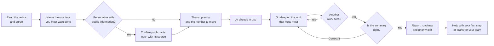
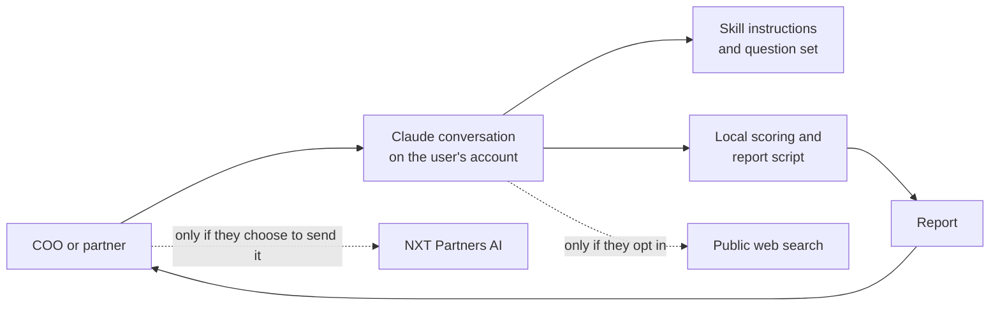

# nxt-fund-blueprint

**A guided assessment in Claude that helps private equity firms decide where to automate, simplify, or add AI in their own operations.**

https://github.com/nxtpartners/nxt-fund-blueprint


The bet: a structured conversation can turn what a COO or partner already knows about how the firm runs into a practical first plan, with no AI background needed. It is free for anyone to use, and it adapts to each firm's thesis.

## How it works



Most questions offer fixed choices, and anything typed is restated for you to confirm before it counts. Everything in the report is something you said, a public fact you confirmed with its source, a labelled planning estimate, general advice from the tool's fixed text, or a short note Claude writes linking a move to the thesis you confirmed.

Each activity gets one verdict: remove it, automate it, optimize it, add AI, add agentic AI with human approval, build on AI already in use, or leave it with people. The verdict depends on how your firm runs that work: where the information lives, who does it, where the time goes, whether it is done mainly from habit, and your AI policy and tools. Each move is then placed by estimated speed against its estimated effect on the number you chose, including through each team's own measures. These come from fixed planning rules applied to your answers. They are not benchmarks or measurements.

## Architecture



NXT Partners AI runs no server for this tool and does not receive your answers. They stay in your Claude conversation, which Claude processes under your account's terms, and in working files created there. If you choose to personalize it, your firm's name is used in a public web search. Please do not enter the names of people, portfolio companies, LPs, or deals. The only name it may ask for is your own firm's, and only if you choose to personalize.

## Technology

| Area | Technology | Use |
|---|---|---|
| Distribution | Claude plugin bundle | The route to the Claude directory |
| Conversation | Agent Skill (`SKILL.md`) | The assessment logic for both Claude surfaces |
| Scoring and report | Python standard library | Same answers, same plan, with nothing to install |
| Output | Self-contained HTML and SVG | A report that opens anywhere and can be printed |

Invariants: no data collection, no statistics or claims about other firms, and no investment, legal, tax, or compliance advice.

## Project structure

```text
.claude-plugin/plugin.json     Plugin name, version, and author
skills/fund-blueprint/
  SKILL.md                     The conversation: flow and rules
  references/                  Question set and activity catalog
  scripts/                     Validation, scoring, and report
  assets/                      NXT logo and fonts
LICENSE                        MIT
README.md                      This file
```

## Requirements

A regular Claude chat with code execution turned on, or Claude Code. It does not run in incognito chats.

## Status

| Area | State |
|---|---|
| Plugin, question set, scoring, and report | In testing, 2026-11-06 |
| Tested on | claude.ai on one paid account, and Claude Code's evaluation sandbox |
| Review by a practitioner | Not started |
| Claude directory listing | Not started |

## License

Released under the [MIT License](LICENSE). The embedded fonts are under the SIL Open Font License 1.1.

Created by NXT Partners AI, [info@nxtpartners.ai](mailto:info@nxtpartners.ai)
