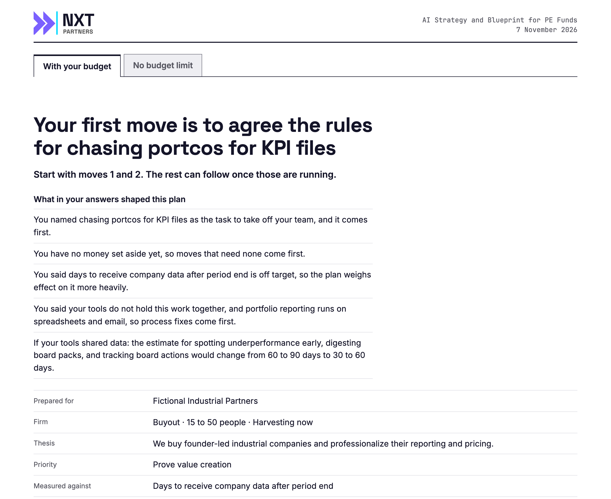
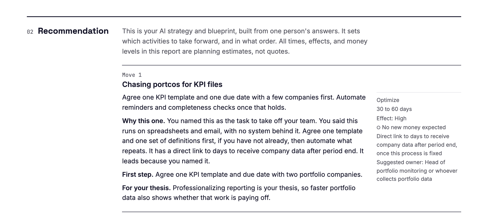
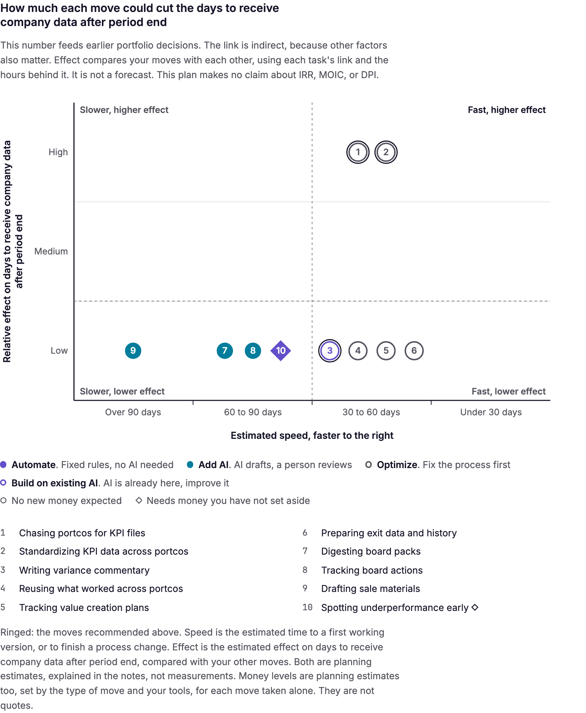
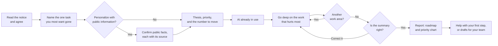
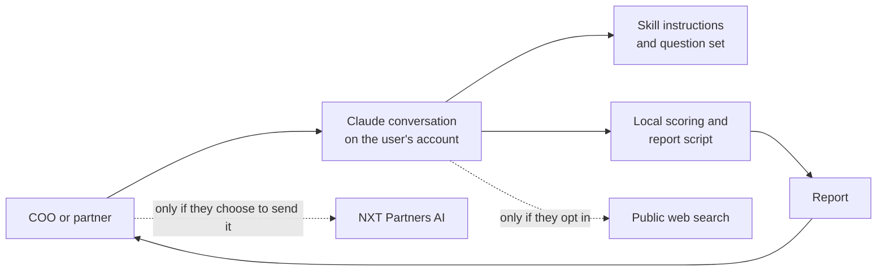

# nxt-fund-blueprint

**A free AI strategy and blueprint in Claude for a private equity firm: where to automate, simplify, or add AI in how the firm itself runs, and what to leave with its people.**

https://github.com/nxtpartners/nxt-fund-blueprint


You answer short questions about how the work runs today, most of them multiple choice. You get a ranked plan with a first step for each move. No AI background is needed, and firms already using AI are asked what is in place, so the plan builds on it.

It covers the firm's own operations, such as fund reporting, LP requests, and deal flow. It does not assess portfolio companies.

## What you get

A report in your chat that you can print or forward. Every image below comes from a sample report for a fictional firm: [download the full sample](examples/sample-report.html) and open it in a browser.

**The first page says what to do first and which of your answers led there.**



**Each move has a verdict, the reason, a first step, a suggested owner, and an estimated money level.**



**A chart places each move by estimated speed against its estimated effect on the number you chose, compared with your other moves.** The chart's y axis names your number, from a short list or typed in your own words, and says which fund result it feeds. It makes no claim about IRR, MOIC, or DPI. If you type your own, Claude estimates each task's link to it and shows those links for you to correct. A circle needs no new money or should fit your budget. A diamond may need money you have not set aside.



When your budget limits the plan, the report has two tabs. "With your budget" puts the moves that fit first and names the move most worth finding money for. "No budget limit" shows the same moves in the normal order. Money levels are planning estimates, not quotes.

The blueprint sets which activities to take forward and in what order, built from one person's answers. It does not check your data, systems, or vendors: the report lists what to scope after it.

The report also has a roadmap, a view by department, the measures each team could track, and a list of work to leave with your people.

Each activity gets one verdict: remove it, automate it, optimize it, add AI that drafts for a person to review, let AI run several steps with a person approving, build on AI already in use, or leave it with people. The verdict depends on your answers: where the information lives, who does the work, where the time goes, whether it is done mainly from habit, and your AI policy and tools.

## Before you start

**Who should answer:** one person who knows how the firm runs, such as a COO or a partner.

**What to have to hand:** nothing. It asks for no documents, and rough guesses are fine.

**How long it is:** about 35 short questions for one part of the firm, plus 3 to 9 for each part you add. You can skip questions, and you choose how deep to go. We have not timed it with a real respondent, so we give no time estimate. In our test on claude.ai, we left the chat, came back, and it carried on with the next question.

**What it costs:** it is free. The report ends with an offer of implementation help from NXT Partners AI, which you can ignore. NXT Partners AI benefits if you hire it, so weigh the plan with that in mind. The scoring rules are in this repo for anyone to read, and they do not refer to NXT Partners AI or its services. It runs on your own Claude plan.

## Install

**Requirements:** a regular Claude chat with code execution turned on, or Claude Code. It does not run in incognito chats. We have tested it on one paid claude.ai account. We have not tested Free, Team, or Enterprise plans, where an administrator may need to allow it.

On claude.ai, build the plugin file, then upload it under **Customize > Plugins**:

```sh
git clone https://github.com/nxtpartners/nxt-fund-blueprint.git   # get the code
cd nxt-fund-blueprint
zip -qr nxt-fund-blueprint.zip .claude-plugin skills README.md LICENSE   # build the plugin file to upload
```

In Claude Code, from the same folder:

```sh
claude --plugin-dir .   # start Claude Code with the plugin loaded
```

Then ask, for example: "Where could automation or AI help how we run our firm?" To remove it on claude.ai, open **Customize > Plugins > Yours** and choose **Remove** from the plugin's menu. In Claude Code, stop passing `--plugin-dir`.

## Where your answers go

NXT Partners AI runs no server for this tool and does not receive your answers. They stay in your Claude conversation, which Claude processes under your account's terms, and in one working file created there. You can ask to see or delete that file at any time.

Two things happen only if you choose them:

- **Personalizing:** your firm's name is used in a public web search, and you confirm each fact it finds before it counts.
- **Writing to NXT Partners AI:** the tool drafts a short summary and you send it yourself. Nothing is sent from the chat.

Please do not enter confidential details, such as the names of people, portfolio companies, LPs, or deals. The only name it may ask for is your own firm's, and only if you choose to personalize.

**What your compliance team may want to check:** whether your firm's Claude account and its terms are approved for this kind of operational description, and whether a public web search on the firm's name is acceptable. The code is here for anyone to read.

## What it does not do

- It does not connect to your systems or ask for your files.
- It gives no investment, legal, tax, or compliance advice.
- It makes no claims about what other firms do, and it has no benchmarks.
- It does not measure anything. Speed and effect are planning estimates from fixed rules applied to your answers, shown as bands. The same answers give the same plan, which makes it repeatable, not proven. The rules were drafted with AI and have not yet been reviewed by a practitioner, so treat them as a starting point for your own judgment.

## How it works



Anything you type is restated for you to confirm before it counts. Everything in the report is something you said, a public fact you confirmed with its source, a labelled planning estimate, general advice from the tool's fixed text, or a short note Claude writes linking a move to the thesis you confirmed.

## Architecture



## Technology

| Area | Technology | Use |
|---|---|---|
| Distribution | Claude plugin bundle | The route to the Claude directory |
| Conversation | Agent Skill (`SKILL.md`) | The assessment logic for both Claude surfaces |
| Scoring and report | Python standard library | Same answers, same plan, with nothing to install |
| Output | Self-contained HTML and SVG | A report that opens anywhere and can be printed |

## Project structure

```text
.claude-plugin/plugin.json     Plugin name, version, and author
skills/fund-blueprint/
  SKILL.md                     The conversation: flow and rules
  references/                  Question set and activity catalog
  scripts/blueprint/           Validation, planning rules, and report sections
  assets/                      NXT logo and fonts
examples/                      Sample report for a fictional firm, and its images
LICENSE                        MIT
README.md                      This file
```

## Status

| Area | State |
|---|---|
| Plugin, question set, scoring, and report | In testing, 2026-11-07 |
| Tested on | Test firms on claude.ai with one paid account, and Claude Code up to the consent question, 2026-11-07. No real firm has used it yet |
| Full question-by-question run in Claude Code | Not started |
| Review by a practitioner | Not started |
| Ready-made download | Not started |
| Claude directory listing | Not started |

## About NXT Partners AI

[NXT Partners AI](https://nxtpartners.ai) made this tool and offers help putting a plan like this into practice. Questions, corrections, and problems: [info@nxtpartners.ai](mailto:info@nxtpartners.ai).

## License

Released under the [MIT License](LICENSE). The embedded fonts are under the [SIL Open Font License 1.1](skills/fund-blueprint/assets/fonts/OFL.txt).

Created by NXT Partners AI, [info@nxtpartners.ai](mailto:info@nxtpartners.ai)
