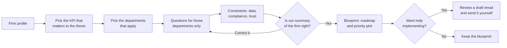
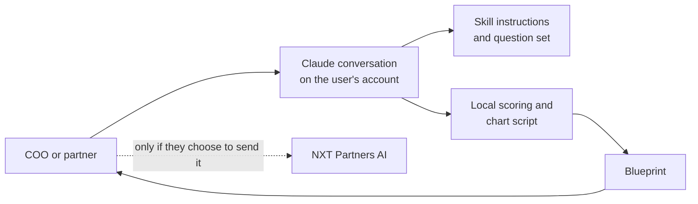

# nxt-fund-blueprint

**A guided assessment in Claude that shows private equity firms where AI, automation, or simply removing a step would help their own operations most.**

https://github.com/nxtpartners/nxt-fund-blueprint


Most AI conversations at a PE firm start with a tool and go looking for a use. Partners and COOs carry the real picture: where deal teams lose hours, which reports get rebuilt every quarter, which steps nobody would miss. This project bets that a short, structured conversation can surface that picture and turn it into a credible first plan, without a workshop or a consultant in the room. It is the first stage of how NXT Partners AI works with PE firms, and it is free to use.

## How it works



Every question offers fixed choices, and anything typed in is restated as a choice for you to confirm before it counts. That keeps answers unambiguous and the results explainable.

Each activity gets one verdict: remove it, automate it, optimize it, add AI, add agentic AI with human approval, or leave it with people. Each one is then plotted by speed of execution against estimated impact on your chosen KPI. Scores are directional estimates based on your answers, not measurements.

## Architecture



NXT Partners AI runs no server for this skill, and the skill does not collect or send anything to NXT. Answers stay in your Claude conversation under your account's terms. Please do not enter LP names, deal names, or other confidential details.

## Technology

| Area | Technology | Use |
|---|---|---|
| Distribution | Claude plugin bundle | The route to directory listing and automatic updates |
| Conversation | Agent Skill (`SKILL.md`) | Holds the assessment logic for both Claude surfaces |
| Scoring and chart | Python standard library | Same answers, same scores, with nothing to install |
| Output | Self-contained HTML and SVG | A blueprint that opens anywhere and can be shared |

Invariants: no external network calls, no data collection, and no investment, legal, or compliance advice.

## Project structure

```text
.claude-plugin/plugin.json     Plugin name, version, and author
skills/fund-blueprint/
  SKILL.md                     The conversation: flow and rules
  references/                  Question set, activity catalog, scoring model
  scripts/                     Scoring and chart generation
  assets/                      Blueprint template
LICENSE                        MIT
README.md                      This file
```

## Status

| Area | State |
|---|---|
| Product definition | Drafted, 2026-11-05 |
| Rendering test on claude.ai and Claude Code | Not started |
| Skill and question set | Not started |
| Scoring and chart | Not started |
| Claude directory listing | Not started |

## License

Released under the [MIT License](LICENSE).

Created by NXT Partners AI, [info@nxtpartners.ai](mailto:info@nxtpartners.ai)
